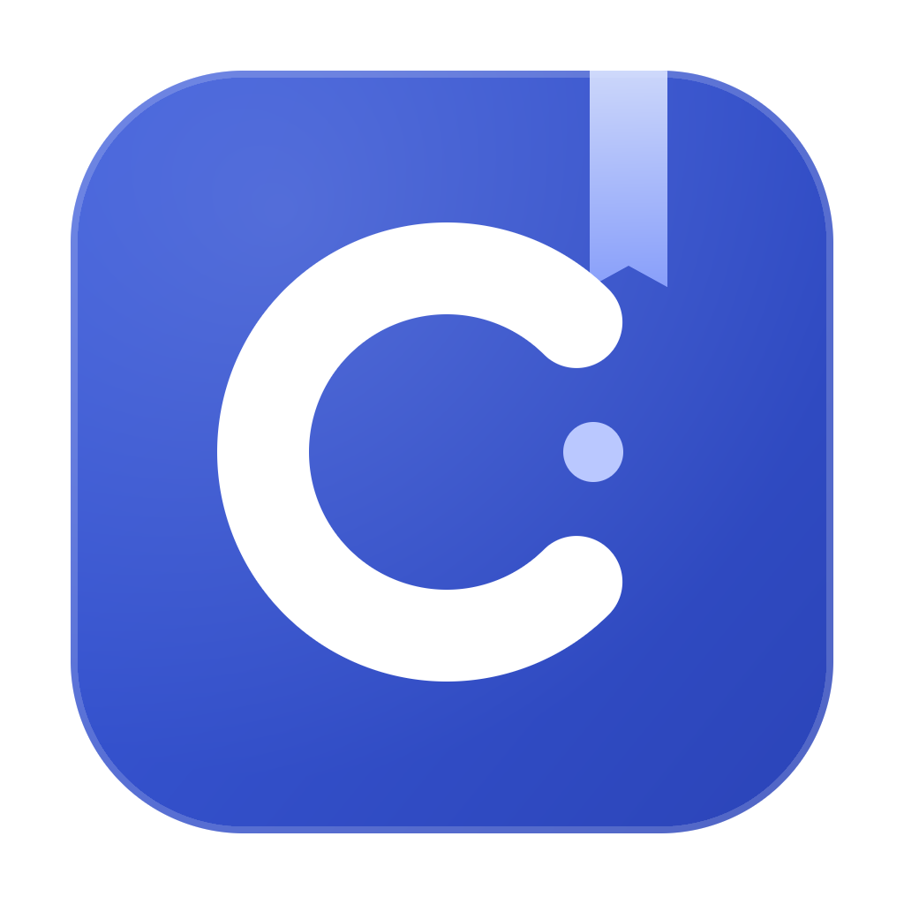

<div align="center">



# Cursada

**Tu cursada universitaria, organizada y 100% local.**

Aplicación de escritorio para macOS que junta materias, horarios, tareas, exámenes y apuntes en un solo lugar, con un asistente de estudio con IA que corre en tu propia máquina.

-1E2023)


</div>

---

## ¿Qué es Cursada?

Cursada es un espacio de trabajo académico **offline-first**: todos tus datos viven en un archivo SQLite en tu Mac, sin cuentas ni servicios en la nube. Combina la organización de la facultad (qué curso, cuándo, qué tengo que entregar, cómo me fue) con un cuaderno de estudio por materia y un asistente de IA local vía [Ollama](https://ollama.com).

## Funcionalidades

### Organización académica
- **Materias** por cuatrimestre, con archivo de cuatrimestres anteriores.
- **Horarios semanales** con aula / sede / modalidad.
- **Calendario** mensual y semanal con clases, entregas y exámenes.
- **Tareas** por materia (pendiente / completada).
- **Exámenes** (Parcial, Recuperatorio, Final, TP) con notas de 1 a 10 y promedio por materia.
- **Asistencia** por materia.
- **Pantalla de inicio** con lo próximo: clases, tareas, exámenes y último informe.

### Cuaderno de estudio
- **Editor Markdown** (CodeMirror 6) con *Live Preview*, tablas y guardado automático.
- **Fórmulas LaTeX** renderizadas con KaTeX, sin conexión.
- **`[[WikiLinks]]`, backlinks** y red de conocimiento entre notas.
- **Búsqueda de texto completo** sin distinguir tildes ni mayúsculas (SQLite FTS5).
- **Importación desde Obsidian** y **exportación a Markdown** (nota, materia o cursada completa).

### Asistente con IA local (opcional)
- **Fuentes** por materia: `.pdf`, `.md`, `.txt` o texto pegado.
- **Chat con citas** sobre tus fuentes y notas (RAG híbrido).
- **Informes de estudio** filtrados por alcance (Todo, 1° Parcial, 2° Parcial, Final) y origen (fuentes / notas).
- **Simulacro de examen** interactivo.
- Todo corre contra Ollama en `localhost`; el modelo se libera de memoria al terminar cada respuesta.

### Extras
- **Temporizador Pomodoro** integrado en la cabecera.
- **Paleta de comandos** (`⌘K`) y atajos de teclado.
- **Modo claro y oscuro** (o según el sistema).
- **Sincronización con Google Calendar** y suscripción a calendarios `.ics`.
- **Backups automáticos** con rotación.

## Requisitos

| Requisito | Detalle |
| --- | --- |
| Sistema | macOS (pensada para Apple Silicon) |
| Node.js | 22 o superior |
| Ollama | Opcional, solo para las funciones de IA (`http://localhost:11434`) |
| `librsvg` | Opcional, solo para regenerar el ícono `.icns` (`brew install librsvg`) |

## Instalación

```bash
git clone https://github.com/tomasflorydev/Cursada.git
cd Cursada
npm install
npm run dev
```

`npm run dev` levanta Vite y abre la app de Electron.

### Comandos disponibles

| Comando | Qué hace |
| --- | --- |
| `npm run dev` | App completa en desarrollo (Vite + Electron) |
| `npm run dev:web` | Solo el frontend en el navegador, con datos de prueba |
| `npm run typecheck` | Verifica tipos de TypeScript (frontend + Electron) |
| `npm test` | Corre la suite de tests (Vitest, con SQLite aislado) |
| `npm run build` | Compila frontend, proceso principal y preload |
| `npm run package` | Genera `release/Cursada.app` |

### IA local (opcional)

1. Instalá [Ollama](https://ollama.com) y dejalo corriendo.
2. Descargá un modelo de chat y uno de embeddings con `ollama pull <modelo>`.
3. En Cursada, andá a **Ajustes → Inteligencia artificial** y elegí los modelos.

Si Ollama no está disponible, el resto de la app funciona igual.

## Tus datos

Todo se guarda localmente en:

```text
~/Library/Application Support/com.cursada.app/
├── cursada.sqlite   # Base de datos (WAL + FTS5 + migraciones)
├── backups/         # Backups automáticos (últimos 15)
└── sources/         # Copias locales de PDFs y fuentes
```

- Se hace un backup al iniciar la app (si pasaron 24 h o más), antes de cada migración de esquema y antes de eliminar una materia.
- Para desarrollo o pruebas podés usar otra carpeta con la variable de entorno `CURSADA_DATA_DIR`.
- Los tests nunca tocan esta carpeta: usan SQLite en memoria o en un directorio temporal.

## Seguridad y privacidad

- Electron endurecido: `contextIsolation`, `sandbox`, sin `nodeIntegration` y CSP estricta.
- El renderer solo habla con el sistema a través de un puente IPC tipado (`window.cursadaApi`) con validación en el backend.
- Consultas SQL 100% parametrizadas.
- Tokens de Google Calendar cifrados con el Llavero de macOS (`safeStorage`).
- Ollama restringido por defecto a hosts locales.

## Atajos de teclado

| Atajo | Acción |
| --- | --- |
| `⌘K` | Paleta de comandos y búsqueda global |
| `⌘1` – `⌘6` | Ir a cada sección principal |
| `⌘N` | Crear algo nuevo según la vista activa |
| `⌘,` | Abrir Ajustes |

## Stack

- **Escritorio:** Electron 44 + Node.js (`node:sqlite`)
- **Frontend:** React 19, Vite, TypeScript, CSS nativo con tokens, `framer-motion`
- **Editor:** CodeMirror 6, `react-markdown` + `remark-gfm`, KaTeX
- **Datos:** SQLite (WAL, FTS5, embeddings para búsqueda semántica)
- **IA:** Ollama (local)
- **Tests:** Vitest + Testing Library + jsdom

## Estructura del proyecto

```text
Cursada/
├── electron/      # Proceso principal: ipc → services → db
├── shared/        # Tipos y utilidades compartidas (WikiLinks, .ics, PDF)
├── src/
│   ├── pages/     # Vistas: Inicio, Materias, Calendario, Tareas, Exámenes, Informes, Ajustes
│   ├── components/
│   ├── ui/        # Componentes base del sistema de diseño
│   ├── lib/       # Cliente API tipado, editor, utilidades
│   ├── styles/    # CSS por capas y tokens
│   └── __tests__/
├── public/        # favicon y theme-init.js
├── build/         # Íconos de la app
└── scripts/       # Desarrollo y empaquetado
```

## Documentación

- [ARCHITECTURE.md](ARCHITECTURE.md) — Arquitectura, esquema SQLite y decisiones técnicas.
- [DESIGN.md](DESIGN.md) — Sistema de diseño (paleta, tipografía, tokens, temas).
- [docs/brand.md](docs/brand.md) — Marca e ícono.
- [ROADMAP.md](ROADMAP.md) — Hoja de ruta por fases.
- [PROGRESS.md](PROGRESS.md) — Estado de implementación.
- [AGENTS.md](AGENTS.md) — Convenciones del repositorio.

## Autor

Hecho por **Tomas Flory**.
